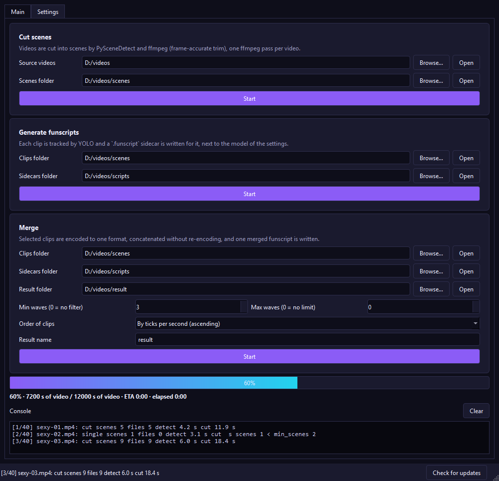
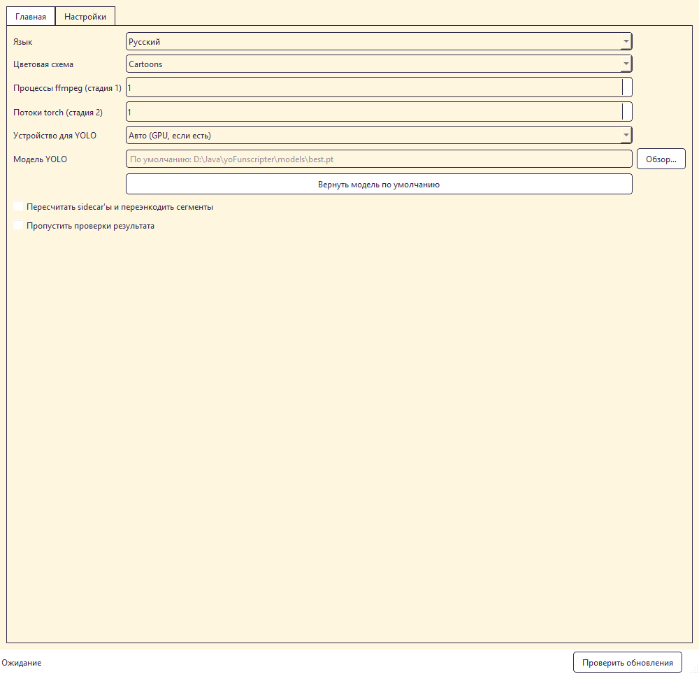

# yoFunscripter

Windows desktop app for three jobs on a folder of videos:

1. **Cut scenes** — split videos into scene clips with PySceneDetect + FFmpeg.
2. **Generate funscripts** — run the YOLO tracking pipeline on the clips and write a
   `.funscript` sidecar for every clip.
3. **Merge** — pick the clips by wave count, encode them to one format, concatenate
   them into one video and merge their funscripts into one script.

The scene detector and the funscript pipeline are the same algorithms and thresholds as
the reference YOLO project; the app only adds the window, folder selection, real
progress (percent, ETA, elapsed) and the log.



The settings page (Russian, the «Cartoons» scheme): language, color scheme, threads of
each stage, device for YOLO, the model file, and the two run options.



## Requirements

- Windows 10/11 x64. FFmpeg and FFprobe are bundled, nothing has to be installed.
- A YOLO model `best.pt` is bundled; the settings can point to another model and reset
  to the default.

## Install

Download `YoFunscripter-Setup-<version>.exe` from
[Releases](https://github.com/flynet/yoFunscripter/releases) and run it. The app lives in
its own folder; the defaults of every stage are subfolders of that folder:

```
scenes\   cut clips of stage 1 (input of stages 2 and 3)
scripts\  .funscript sidecars of stage 2 (input of stage 3)
result\   merged video + merged funscript
work\     intermediates (scene lists, segment cache, reports); safe to delete
```

The **Check for updates** button reads the latest GitHub release and downloads and runs
its installer.

## Use

**Settings** — language (English/Russian), colour scheme, threads, device
(`auto` / `cpu` / `cuda`), model file. The window state, folders and thresholds are saved
in `%APPDATA%\YoFunscripter\settings.json`.

**Cut scenes** — pick a source folder (required), an output folder (default `scenes`),
a file pattern and the number of parallel jobs, then **Start**. Every video gets a scene
list CSV and one clip per scene; a single-scene video is reported as `single` and not
cut.

**Generate funscripts** — pick the clips folder (default `scenes`) and the scripts folder
(default `scripts`). A sidecar newer than its clip is reused; a replaced clip is
regenerated. Progress is measured in frames.

**Merge** — pick the clips folder, the scripts folder, the output folder (default
`result`) and the name. Clip order: tick rate (default), waves ascending/descending,
keep the folder order, random. `min_waves` (default 3) drops clips with fewer waves,
`0` keeps everything. The encode + concat progress is measured in seconds of video.

## Build from source

```powershell
uv sync                          # Python 3.12 venv with the CPU torch wheels
powershell -ExecutionPolicy Bypass -File build.ps1
# GPU machine: the cu126 wheels instead of the CPU ones
powershell -ExecutionPolicy Bypass -File build.ps1 -Cuda
```

`build.ps1` writes the version from `git describe --tags`, bundles `bin\ffmpeg.exe`,
`bin\ffprobe.exe` (from `tools\ffmpeg`, else from the machine, else downloaded by
`tools\fetch_ffmpeg.ps1`), runs PyInstaller (onedir) and, when Inno Setup 6 is installed,
builds `dist\install\YoFunscripter-Setup-<version>.exe` with its `.sha256` file.

Development run without packaging:

```powershell
run.bat
```

The README screenshots are rendered by the app's own window code (offscreen, no run):

```powershell
.venv\Scripts\python.exe tools\make_screenshots.py
.venv\Scripts\python.exe tools\make_icon.py       # assets\icon.ico
```

## Tests

```powershell
uv run pytest
```

The tests cover the Qt-free parts: the updater (release parsing, versions, resume of the
installer download), settings (atomic save, backup), the i18n catalogs, the progress
meter and the merge selection rules. The pipelines need real video and a model, so they
are tested by running the app.

## License

MIT, see `NOTICE`. FFmpeg is the GPL build of the FFmpeg project, and the bundled
Ultralytics model and library are AGPL-3.0: see `NOTICE` for the links.
